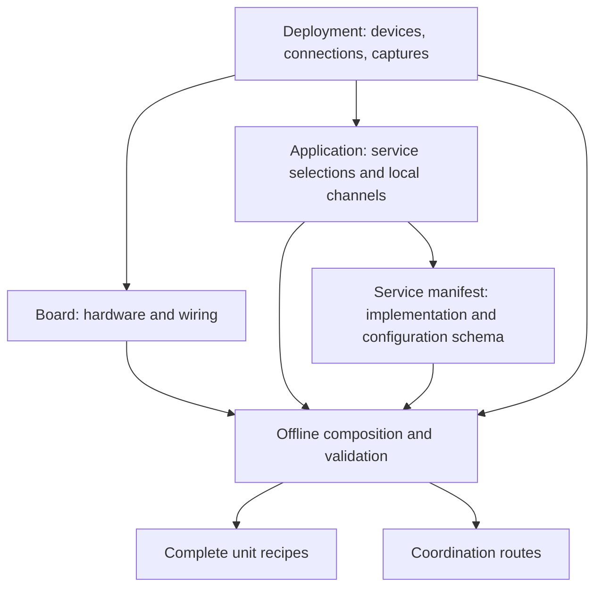

# Configure a system from one deployment

This is the preferred authoring workflow for new composed deployments. Existing
unit and standalone recipes remain supported; see [configuration ownership](../../../README.md#repository-map).

Start at [deployments/ir.toml](../../../config/deployments/ir.toml). It answers three questions:
which physical devices participate, what each runs, and what crosses the network.

```toml
[devices.feather]
id = "e89f6d30e1a8"
board = "../boards/feather-ir.toml"
application = "../applications/ir-receiver.toml"

[[connections]]
name = "ir.target"
from = "controller.controller.target"
to = "feather.ir.target"

[streams.frames]
from = "feather.ir.frames"
```

An endpoint is `device.service.port`. The repeated `controller.controller` means
the device alias followed by its service alias; neither is a network address.
The source and destination may use different local channel names and numeric keys.

## Review it locally

```sh
./micros compose deployments/ir.toml
./micros compose deployments/ir-wroom.toml
./micros compose deployments/dht.toml
```

These commands read and validate configuration without contacting a server or
device. They show hardware identities, board and application files, selected
services, service connections, and captures. `--json` shows the expanded values.

To produce recipes that the current build and deployment tools can consume:

```sh
./micros compose deployments/ir.toml --output build/ir-review
./micros config --project build/ir-review/units/e89f6d30e1a8.toml
```

The output directory must be new. It contains complete `units/DEVICE_ID.toml`
files, `coordination.toml`, and `composition.json` with resolved values and board
and application source paths. A validation failure publishes no bundle.
Paths inside generated units are absolute to the current checkout. These are
local build inputs, not portable release bundles or snapshots of source code.

## Where an edit belongs

| Change | Edit |
| --- | --- |
| Put the controller on another physical device | The deployment's device ID and board/application references |
| Connect a service output to another device | `[[connections]]` in the deployment |
| Make a published channel available for capture | `[streams.NAME]` in the deployment |
| Change pins or hardware profile | The referenced `boards/*.toml` |
| Select services, budgets, startup settings, or local channel bindings | The referenced `applications/*.toml` |
| Change source files, version, required resources, or configuration schema | `service.toml` beside that service's source |
| Add support for a different MCU/SDK | `platforms/` and its existing platform tooling |



There is no arbitrary inheritance or deep merge. Paths resolve relative to the
file that declares them. An application selects a service manifest and supplies
only its memory budget, configuration values, and port bindings. Its manifest
owns build inputs, capabilities, version, and setting definitions. A board owns
physical wiring. The deployment supplies device identity and management-server
settings. Existing application SDK build requirements retain their current
`project` fields; composition does not add another platform configuration format.

## Connections and captures have different meanings

**Connections** link coordination state, action, or event ports. Composition
checks direction, kind, protobuf schema, interface version, and payload bounds
offline. The existing router still performs live admission against device
identities and activations. Its current limit of eight routes and one route per
physical endpoint remains. Ordinary local channels cannot be used as coordination
connections.

**Streams** expose an ordinary service publication for network viewing. The
compiler adds the existing `network-bridge` service as the final service slot,
with a 2048-byte RAM stack, and binds one subscription per named capture. For
example, `streams.frames` becomes the bridge port `frames`. The production loader
checks the bridge's handle limit along with other resource grants. With no
captures, no bridge is added. `bridge` is reserved in composed applications.
This initial format supports outbound captures; inbound network writes continue
to use the existing explicit bridge recipe format.

Declaring a stream makes it available after deployment. It does not start capture
or change retention, delivery guarantees, or the server's demand leases. Multiple
viewers still share the existing server drain. See the
[network bridge contract](../../../src/services/network-bridge/README.md).

Connections default to `drop_first = 0`. The older coordination demonstrations
use three deliberately dropped advertisements to test recovery. Set `drop_first`
explicitly only for a fault-injection experiment; the preview calls it out.

## Using a reviewed composition

This is an executable authoring redesign for review. Existing `units/*.toml`,
onboarding defaults, and saved device selections remain supported. They do not
automatically follow edits to `applications/` or `deployments/`; recomposition and
an explicit generated `--project` select the new inputs.

When choosing to deploy, use the normal platform workflow with the corresponding
generated unit file. For example, the Feather application can be selected with:

```sh
./micros deploy -d e89f6d30e1a8 --project build/ir-review/units/e89f6d30e1a8.toml
```

Build/deploy the other participating device through its normal platform workflow
as well. Only after the selected applications are deployed, use the generated
route file with the existing live preview and apply commands:

```sh
build/python/bin/python -m micros_tooling.fleet.coordination preview --project build/ir-review/coordination.toml
build/python/bin/python -m micros_tooling.fleet.coordination apply --project build/ir-review/coordination.toml
```

Live preview requires server access and online devices. Apply changes server
routes. Neither happens as part of `compose`. The existing admission limitation
still applies: authored contracts are validated, but the route compiler does not
reconstruct the complete authored graph against the archived release. See
[coordination](COORDINATION.md) for lifecycle and delivery behavior.

The regression suite compares the generated recipes with all four existing unit
recipes, including service slots, settings, channel identities, and GPIO mappings.
The generated route files also pass through the existing coordination compiler
using a test roster. No hardware behavior is inferred from those offline tests.
