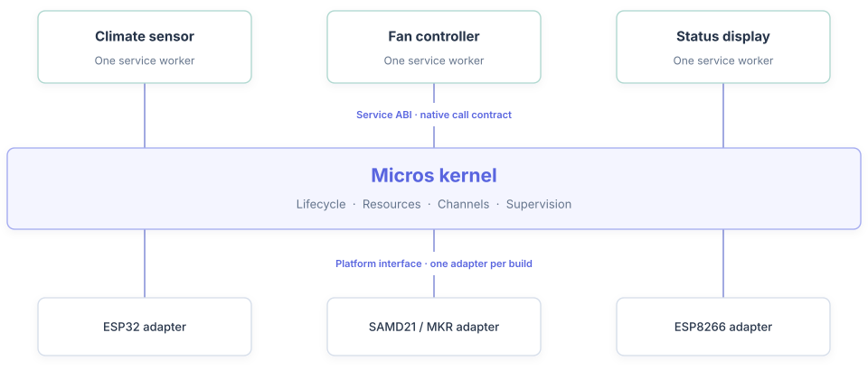
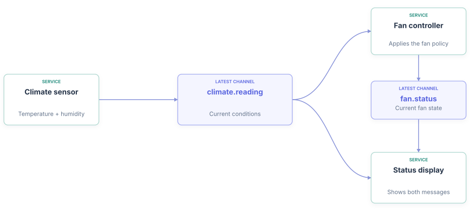

<strong>Start with the current SDK:</strong> <a href="site/get-started/#install-cli">Follow the Quickstart</a> to install the tools and create your first application. <a href="site/preview-evidence/">Historical preview evidence and limits</a> remain available for reference.

  
  Meet Micros · architecture &amp; tradeoffs
  <h1>One greenhouse. An application you can change.</h1>
  
A greenhouse needs to measure its climate, control a fan, and show what is happening. Later, you will want to change how it responds.

  
Micros makes those jobs native services that you compose into an application. The resident base provides the kernel, platform support, and management facilities that load and manage them. Application changes can follow their own update path.

  
Design example: three proposed greenhouse services, used to explain Micros. The greenhouse implementation and readings below are illustrative.

  <nav class="story-index" aria-label="Follow the application"><a href="#execution">01 Kernel</a><a href="#communication">02 Messages</a><a href="#composition">03 Composition</a><a href="#updates">04 Change &amp; verify</a></nav>

<section class="story-section" id="execution">
  
  
01
Give each job a home<h2>Three services. One shared kernel.</h2>

  
Start with three jobs: Climate sensor measures conditions, Fan controller applies the ventilation policy, and Status display explains the result. Each service instance runs its lifecycle hooks and callbacks on one worker.

  <figure class="story-figure" data-chart="system">
    

<h3>One service model, across different controllers</h3>
Shared kernel code · a separate native build for each target

Responsibilities

    

      <picture class="story-fallback"><source media="(max-width: 760px)" srcset="assets/visual-storyboard/system-mobile.svg"></picture>
    

    <figcaption>The kernel owns the service lifecycle and resources. A separate supervisor task within its runtime detects overdue work. The underlying platform schedules workers; ESP32 uses ESP-IDF and FreeRTOS.</figcaption>
  </figure>
  

    
<strong>The service ABI connects compiled code.</strong> The Application Binary Interface defines lifecycle hooks and the kernel functions a service can call. Services compile separately; admission checks their target and ABI compatibility. The current ABI is experimental.

    
<strong>The platform interface connects the kernel to hardware.</strong> Each adapter provides tasks, time, memory, and supported hardware operations. Shared kernel source gets a target-specific build. Service binaries and required peripherals must also match the target.

  

  
The tradeoff
<strong>Native services have no enforced memory isolation.</strong> A fault can affect other services or management, and a stalled hook can require whole-runtime recovery.

  
<a href="site/service-boundaries/">Follow a service call through the ABI and platform layer →</a>

</section>

<section class="story-section" id="communication">
  
02
Let the jobs work together<h2>The greenhouse warms. The services respond.</h2>

  
The workers now need to exchange information. Climate sensor publishes a reading. Fan controller decides whether to ventilate and publishes its own status. Status display brings both messages together.

  <figure class="story-figure" data-chart="communication">
    

<h3>Follow the information through the application</h3>
Three services · two typed channels

Message flow

    

      <picture class="story-fallback"><source media="(max-width: 760px)" srcset="assets/visual-storyboard/communication-mobile.svg"></picture>
    

    
<strong>Each reader advances independently.</strong> Reading a message does not remove it for another service. The display can read climate and fan status at its own pace.

    <figcaption>This design uses <code>latest</code> channels: each retains the current value, so a slow display may skip intermediate states. The two messages can arrive at different times; the display should use timestamps to check their freshness.</figcaption>
  </figure>
  
The choice
<strong>Choose retention for the information.</strong> Current temperature suits a latest-value channel. A history of transitions needs a bounded stream and explicit handling of missed messages. Successful publication alone does not establish that another service acted.

</section>

<section class="story-section" id="composition">
  
03
Turn the design into an application<h2>One TOML. Three services. One application.</h2>

  
Those connections are application choices. An application TOML selects reusable service definitions, supplies settings and budgets, and binds ports to channels. Here is how the greenhouse's three jobs fit together.

  <figure class="story-figure story-composition">
    

<h3>Read the file beside the application it describes</h3>
applications/greenhouse.toml · illustrative excerpt

Composition

    

      
<pre><code>[services.climate]
manifest = "../services/climate/service.toml"
memory = { arena = "RAM", stack_bytes = 2048 }
publications.reading = { channel = "climate" }</code></pre>
Climate sensor
Select the implementation and publish readings to the <code>climate</code> channel.

      
<pre><code>[services.fan]
manifest = "../services/fan/service.toml"
memory = { arena = "RAM", stack_bytes = 2048 }
<mark>config = { start_celsius = 28 }</mark>
subscriptions.reading = { channel = "climate" }
publications.status = { channel = "fan_status" }</code></pre>
Fan controller
Use the same reading channel, set the ventilation threshold, and publish fan status.

      
<pre><code>[services.display]
manifest = "../services/display/service.toml"
memory = { arena = "RAM", stack_bytes = 2048 }
subscriptions.reading = { channel = "climate" }
subscriptions.fan = { channel = "fan_status" }</code></pre>
Status display
Subscribe to both channels. The bindings match the two incoming arrows above.

    

    <figcaption>The channel aliases <code>climate</code> and <code>fan_status</code> refer to declarations for <code>climate.reading</code> and <code>fan.status</code>. The full design includes those declarations and schemas. The shown budgets are illustrative; implementations must be sized and validated.</figcaption>
  </figure>
  
<strong>One file assembles existing services.</strong> Each service's manifest describes its implementation and setting schema. A board file owns wiring; a deployment selects the board, application, and device. The application file brings the software together.

  
<a href="site/compose-an-application/">Explore the complete TOML design and try offline composition →</a>

</section>

<section class="story-section" id="updates">
  
  
04
Make one useful change<h2>Start the fan earlier. Keep the resident base.</h2>

  
Now suppose the greenhouse should ventilate sooner. Change Fan controller's startup setting from 28°C to 26°C, then prepare a new application selection. The resident base stays in place; on the normal ESP32 service-update path, the application graph pauses for staging.

  
Fan controller · startup configuration<code><del>start_celsius = 28</del><b aria-hidden="true">→</b><ins>start_celsius = 26</ins></code>

  <figure class="story-figure" data-chart="update">
    

<h3>Follow the changed application through deployment</h3>
ESP32 service update · equal-width phases, not elapsed time

Behavior

    
<button type="button" data-choice="success" aria-pressed="true">Successful update</button><button type="button" data-choice="failure" aria-pressed="false">Failed startup</button>

    

      <picture class="story-fallback"><source media="(max-width: 600px)" srcset="assets/visual-storyboard/update-mobile.svg"></picture>
    

    
All three greenhouse workers pause for staging, then the candidate runs as a trial. The new selection becomes recorded good after confirmation. Resident management remains available during a normal service update.

    <figcaption>Changing one service's setting still uses the application update boundary. Replacing the kernel or platform support is a separate base-firmware operation. Native faults can disrupt management too.</figcaption>
  </figure>
  

    Close the loop
    <h3>A running application is the start of verification.</h3>
    
After deployment, inspect service health and diagnostics. Then check the behavior you intended: with a fresh, valid reading of 27°C, a fan starting off should now turn on and the display should report it.

    

      
Test input<strong>27°C</strong><small>Fresh, valid climate reading</small>

      
Old threshold · 28°C<strong>Fan stays off</strong><small>Temperature below threshold</small>

      
New threshold · 26°C<strong>Fan turns on</strong><small>Display reports the new status</small>

    

    
Illustrative acceptance check for the proposed policy. Runtime trial confirmation establishes liveness; the fan response and display result establish application behavior.

  

  
<a href="site/updates-and-recovery/">Understand rejection, failed trials, and recovery →</a>

</section>

  
  <h2>Take this model into your own application.</h2>
  
Evaluate <a href="site/is-micros-a-fit/">whether Micros fits your requirements</a>, then follow the architecture or try an existing application.

  
<a href="site/compose-an-application/"><strong>Try composition locally →</strong>Inspect a real sensor application without a device.</a><a href="site/service-boundaries/"><strong>Explore the service contract →</strong>ABI, lifecycle, resource ownership, and platform support.</a><a href="site/get-started/"><strong>Choose your hardware →</strong>Follow the setup path for your target.</a>

**Contracts behind the story:** [worker ownership and supervision](site/resources-and-failures.md), [bounded channels](site/messages-within-a-device.md), [composition](site/compose-an-application.md), and [updates and recovery](site/updates-and-recovery.md).
{: .story-sources}

- [Interactive device shell](site/interactive-shell.md): inspect services, stream logs and invoke deployed commands.
